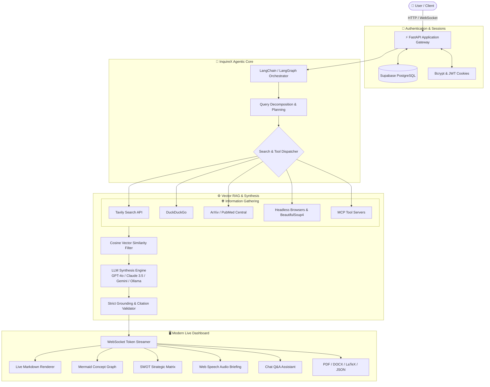

<div align="center">

# 🧠 InquireX

### Autonomous Agentic Deep Research & Intelligence Platform

[](https://python.org)
[](https://fastapi.tiangolo.com)
[](https://langchain.com)
[](https://supabase.com)
[](https://websockets.readthedocs.io)
[](LICENSE)

<p align="center">
  <b>InquireX</b> is an autonomous multi-agent research platform designed to automate deep information gathering, source validation, context filtering, and publication-ready report synthesis on any topic in minutes.
</p>

[Key Features](#-key-features) • [Architecture](#-architecture) • [Tech Stack](#-tech-stack) • [Quick Start](#-quick-start) • [Environment Variables](#-environment-variables) • [Project Structure](#-project-structure)

---

</div>

## 🌟 Key Features

### 🔍 Autonomous Multi-Agent Web Research
- **Decomposed Sub-Query Planning:** Automatically breaks down complex questions into targeted search vectors.
- **Parallel Multi-Source Retrieval:** Concurrently queries search providers (**Tavily**, **DuckDuckGo**, **Google Search**, **Bing**, **SearXNG**, **ArXiv**, and **PubMed Central**).
- **Deep Web Crawling & Scraping:** Extracts clean article content, strips boilerplate, and removes duplicates across dozens of web pages simultaneously.

### 🛡️ Strict Anti-Hallucination & Provenance Tracking
- **Fact-Grounded Synthesis:** Enforces strict contextual alignment where all claims must be backed by retrieved evidence.
- **Exhaustive Citation Ledger:** Automatically catalogs and hyperlinks every visited source URL in a deterministic bibliography.
- **Real-Time Provenance Dashboard:** Computes live metrics for total prose words, estimated read times, cited primary sources, and verified analytical pillars.

### 📊 Interactive Visual Intelligence
- **Mermaid.js Concept Knowledge Maps:** Automatically generates interactive, zoomable concept graphs and structural hierarchies illustrating the core relationships of the research.
- **SWOT Strategic Matrix:** Extracts and categorizes Strengths, Weaknesses, Opportunities, and Threats from research findings.
- **Topic-Adaptive Deep-Dive Vectors:** Evaluates the finished synthesis and recommends contextual follow-up exploration angles tailored to the subject.

### 🎙️ AI Audio Executive Briefings
- **In-Browser Audio Narration:** Built-in speech synthesis engine that delivers spoken executive briefings of research reports.
- **Voice & Speed Controls:** Configurable reading speeds (`0.85x` - `1.0x`) and natural tone settings for listening on the go.

### 💬 Interactive Research Chat
- **Context-Aware Follow-Up Q&A:** Ask doubts, clarify specific points, or request deeper analysis directly from the synthesized report context with memory persistence.

### 🔐 Enterprise Authentication & Session Management
- **Supabase PostgreSQL Integration:** Secure user credential management and profile persistence.
- **Native Bcrypt & JWT Security:** High-performance salted password hashing with stateless JSON Web Tokens stored in HTTP-only cookies.

### 🔌 Model Context Protocol (MCP) Support
- **Universal Tool Extensibility:** Native integration with the Anthropic Model Context Protocol (`mcp`), allowing agents to retrieve live data from local file systems, databases, and custom MCP tool servers.

### 📄 Omni-Format Document Export
- Export research documents in one click to:
  - 📕 **PDF Document** (print-ready with styling)
  - 📘 **Word Document (.docx)**
  - 📝 **Markdown (.md)**
  - 📑 **Academic LaTeX (.tex)**
  - 📊 **Audit Telemetry (.json)** with full timestamped logs and API cost tracking

---

## 🏛️ Architecture



---

## 💻 Tech Stack

| Tier | Technologies |
| :--- | :--- |
| **Backend Framework** | Python 3.11+, FastAPI, Uvicorn, AsyncIO, Pydantic v2 |
| **Agentic Framework** | LangChain v1, LangGraph, LiteLLM |
| **Supported LLMs** | OpenAI (GPT-4o), Anthropic (Claude 3.5 Sonnet), Google Gemini, Ollama (Local), Groq, Mistral |
| **Retrievers & Search** | Tavily Search, DuckDuckGo (`ddgs`), ArXiv, SearXNG, Google Search, Bing |
| **Scraping & Ingestion**| BeautifulSoup4, PyMuPDF (`fitz`), LXML, Unstructured, Playwright |
| **Vector & RAG** | LangChain Text Splitters, OpenAI Embeddings, Cosine Similarity, Tiktoken |
| **Extensibility** | Model Context Protocol (`mcp`), `langchain-mcp-adapters` |
| **Authentication & DB** | Supabase, PostgreSQL, `bcrypt`, Python-JOSE (JWT) |
| **Frontend UI** | HTML5, CSS3 Glassmorphism, Modern Vanilla JS, Bootstrap 4, FontAwesome 6 |
| **Visualization & Speech**| Mermaid.js v10, Showdown.js, DOMPurify, Web Speech API |
| **Document Export** | `python-docx`, `htmldocx`, `md2pdf`, `weasyprint`, LaTeX engine |

---

## 🚀 Quick Start

### 1. Prerequisites
- **Python 3.11+** installed on your machine.
- Git installed.
- (Optional) A [Tavily](https://tavily.com) API key for deep web search and an [OpenAI](https://platform.openai.com) or [Anthropic](https://console.anthropic.com) API key.

### 2. Clone the Repository
```bash
git clone https://github.com/your-username/inquirex.git
cd inquirex
```

### 3. Create and Activate a Virtual Environment
```bash
# On Windows
python -m venv venv
.\venv\Scripts\activate

# On Linux / macOS
python3 -m venv venv
source venv/bin/activate
```

### 4. Install Dependencies
```bash
pip install --upgrade pip
pip install -r requirements.txt
pip install -e .
```

### 5. Configure Environment Variables
Create a `.env` file in the project root:
```bash
cp .env.example .env
```
Populate your `.env` with your API keys:
```ini
# LLM Providers
OPENAI_API_KEY=your_openai_api_key_here
# ANTHROPIC_API_KEY=your_anthropic_api_key_here
# GEMINI_API_KEY=your_gemini_api_key_here

# Search Retriever
RETRIEVER=tavily
TAVILY_API_KEY=your_tavily_api_key_here

# Fast/Smart Model Configuration
SMART_LLM_MODEL=gpt-4o
FAST_LLM_MODEL=gpt-4o-mini

# Authentication & Supabase (Optional for multi-user session protection)
SUPABASE_URL=your_supabase_project_url
SUPABASE_ANON_KEY=your_supabase_anon_key
SUPABASE_SERVICE_ROLE_KEY=your_supabase_service_role_key
SECRET_KEY=generate_a_random_secure_hex_key_here
```

### 6. Run the Application
```bash
python -m uvicorn main:app --host 127.0.0.1 --port 8000 --reload
```

Open your browser and navigate to:
```
http://127.0.0.1:8000
```

---

## ⚙️ Environment Variables Reference

| Variable | Description | Default |
| :--- | :--- | :--- |
| `OPENAI_API_KEY` | OpenAI API Key for GPT models and embeddings | Required (or Anthropic/Gemini) |
| `TAVILY_API_KEY` | Tavily Search API key for web research | Recommended |
| `SMART_LLM_MODEL` | Primary model for complex report synthesis | `gpt-4o` |
| `FAST_LLM_MODEL` | Lightweight model for sub-queries and summarization | `gpt-4o-mini` |
| `DOC_PATH` | Path for uploaded custom documents | `./my-docs` |
| `SUPABASE_URL` | Supabase instance URL for user database | Optional |
| `SUPABASE_SERVICE_ROLE_KEY` | Supabase service-role key for authentication management | Optional |
| `SECRET_KEY` | Secret key for JWT cookie encryption | Generated / Random string |
| `MAX_SEARCH_RESULTS_PER_QUERY` | Maximum number of results to fetch per sub-query | `5` |
| `TOTAL_WORDS` | Default target report length | `1200` |

---

## 📁 Project Structure

```
inquirex/
├── backend/
│   ├── auth/              # Supabase DB, Bcrypt, JWT auth middleware & endpoints
│   ├── chat/              # Chat Q&A agent with report context memory
│   ├── report_type/       # Basic, Detailed, and Deep Research strategies
│   └── server/            # FastAPI app routes, WebSocket manager, server utilities
├── frontend/
│   ├── index.html         # Main InquireX interactive dashboard
│   ├── login.html         # User authentication sign-in
│   ├── register.html      # User registration page
│   ├── scripts.js         # Frontend controller, WebSockets, Mermaid & Audio engine
│   └── styles.css         # Glassmorphism dark-neon theme
├── gpt_researcher/        # Core agentic research engine
│   ├── actions/           # Query generation, web scraping, markdown processing
│   ├── document/          # Ingestion loaders (PDF, DOCX, TXT)
│   ├── llm_provider/      # Multi-provider integrations (OpenAI, Claude, Gemini, Ollama)
│   ├── retrievers/        # Search engines (Tavily, DDG, Google, Bing, ArXiv, MCP)
│   ├── scraper/           # Web page scrapers & text extractors
│   └── skills/            # Research planner, context compression, writer
├── outputs/               # Saved research reports (.md, .pdf, .docx, .json)
├── main.py                # Server entry point
├── requirements.txt       # Python dependencies
└── README.md              # Project documentation
```

---

## 📄 License

This project is open-source and available under the [MIT License](LICENSE).
