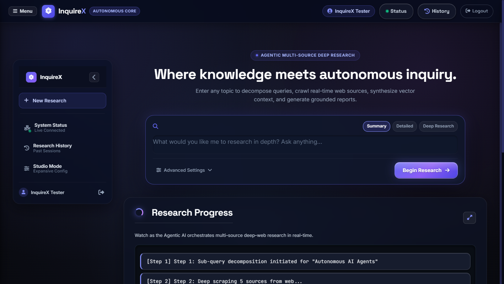
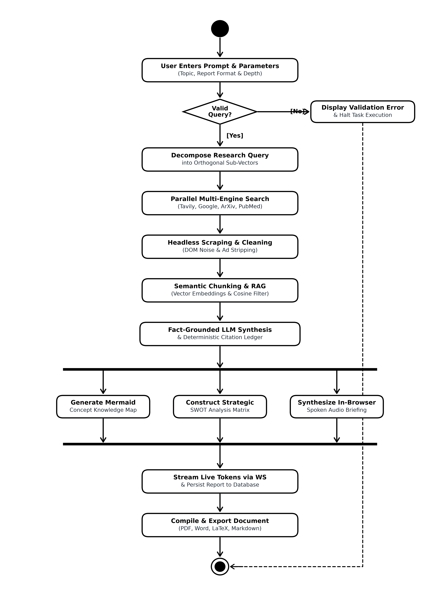
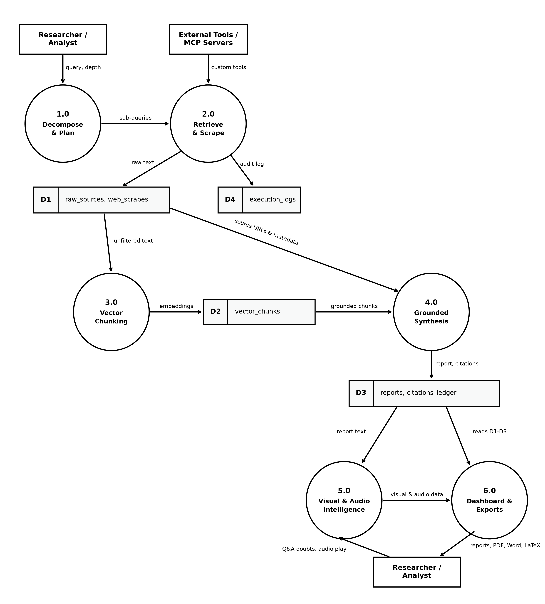
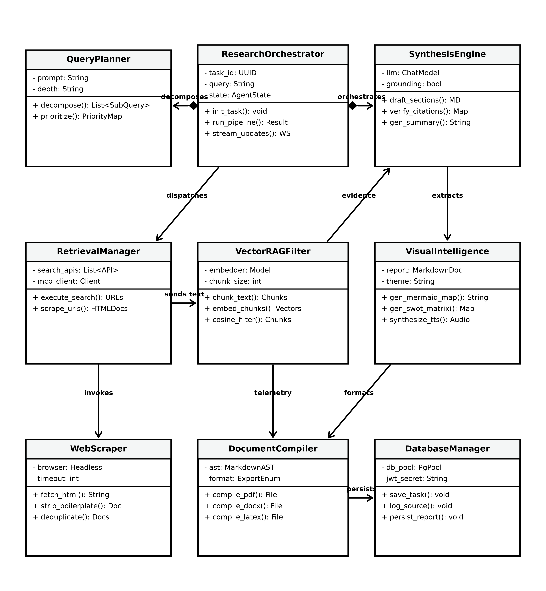
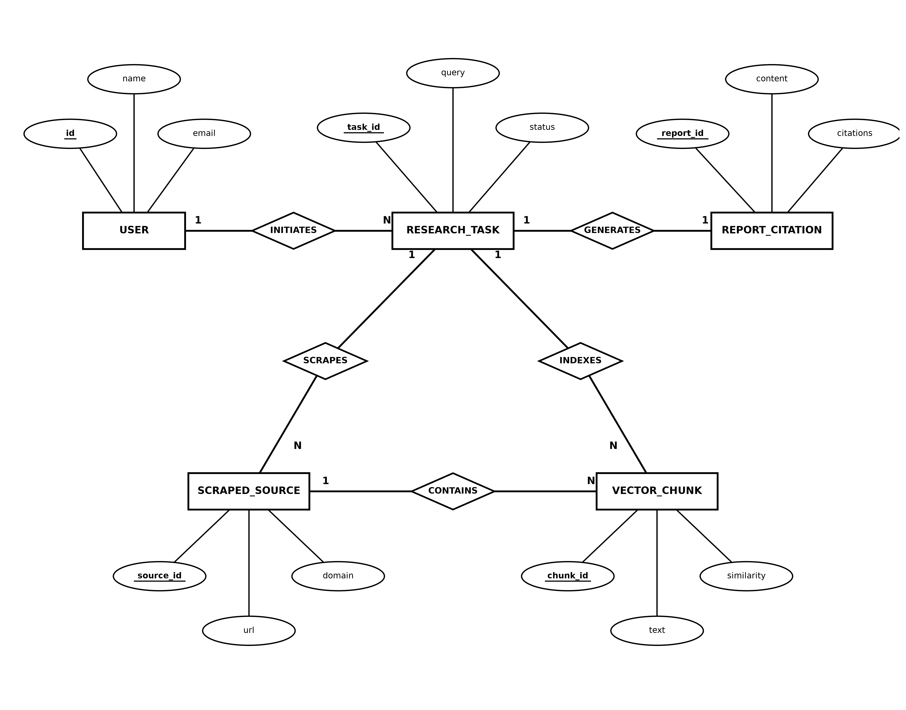
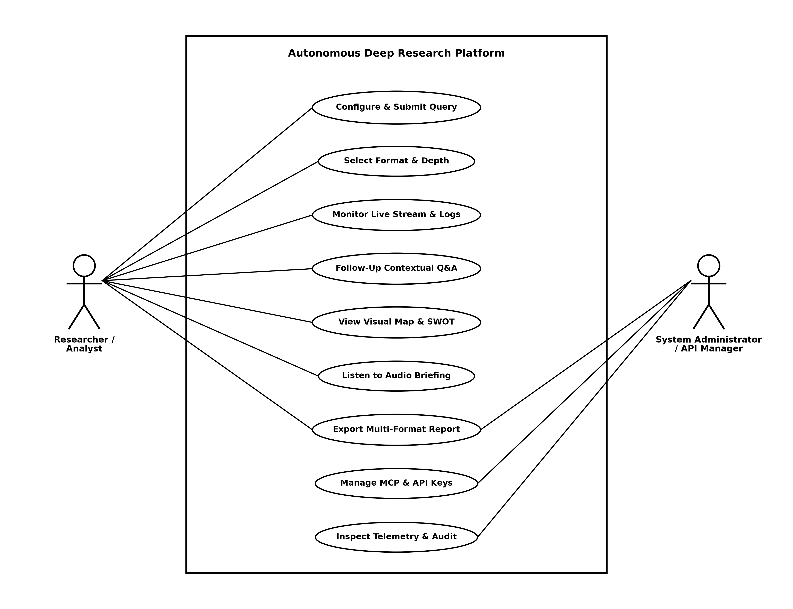

<div align="center">

# 🧠 InquireX

### Autonomous Deep Research Engine & Intelligence Platform
*Where knowledge meets autonomous inquiry.*

[](https://python.org)
[](https://fastapi.tiangolo.com)
[](https://langchain.com)
[](https://modelcontextprotocol.io)
[](https://m8ven.ai/mcp/bhaskararao-aerupilli/inquirex?s=readme)
[](https://supabase.com)
[](https://websockets.readthedocs.io)
[](LICENSE)

<p align="center">
  <b>InquireX</b> is a production-grade autonomous deep research platform powered by multi-agent decomposition, parallel web & academic retrieval, semantic vector compression, interactive knowledge graphs, presentation slide decks, Supabase multi-user persistence, and a voice-enabled <b>AI Companion</b>.
</p>

<!-- Live Preview Demo Above the Fold -->
<p align="center">
  
</p>

</div>

---

### ⚡ 30-Second Quickstart

Get InquireX running locally in 4 simple commands:

```bash
# 1. Clone the repository
git clone https://github.com/BhaskaraRao-Aerupilli/InquireX.git
cd InquireX

# 2. Create and activate virtual environment
python -m venv venv
# Linux / macOS:
source venv/bin/activate
# Windows PowerShell:
.\venv\Scripts\Activate.ps1

# 3. Install dependencies & configure keys
pip install -r requirements.txt
cp .env.example .env    # Configure your LLM key (e.g., GROQ_API_KEY, GEMINI_API_KEY, OPENROUTER_API_KEY, or OPENAI_API_KEY) and TAVILY_API_KEY

# 4. Start the engine
python -m uvicorn main:app --host 127.0.0.1 --port 8000 --reload
```

Open [http://localhost:8000](http://localhost:8000) in your browser and enter any research question or hypothesis.

---

<div align="center">

[⚡ Quickstart](#-30-second-quickstart) • [🌟 Key Features](#-key-features) • [🏛️ System Architecture](#️-system-architecture) • [📐 UML Diagrams](#-system-design--uml-diagrams) • [💻 Tech Stack](#-tech-stack) • [🚀 Detailed Setup](#-detailed-installation--configuration) • [⚙️ Configuration](#️-environment-variables-reference) • [📁 Structure](#-project-structure) • [🔌 API Protocol](#-api--websocket-protocol) • [📄 License](#-license)

---

</div>

## 🌟 Key Features

### 🔍 Autonomous Multi-Agent Web Research
- **Dynamic Sub-Query Decomposition:** Automatically dissects complex research objectives and hypotheses into parallel, targeted search queries.
- **Concurrent Multi-Source Aggregation:** Concurrently queries diverse search engines and scientific repositories (**Tavily**, **DuckDuckGo**, **Google Search**, **Bing**, **ArXiv**, **PubMed Central**, and **SearXNG**).
- **Deep Web Crawling & Scraping:** Strips boilerplate, navigates dynamic web content, extracts clean prose, and deduplicates information across dozens of web pages simultaneously.

### 🛡️ Strict Anti-Hallucination & Provenance Verification
- **Evidence-Grounded Synthesis:** Enforces strict contextual alignment where every synthesis claim must be supported by retrieved and verified source vectors.
- **Deterministic Citation Ledger:** Automatically catalogs, validates, and hyperlinks all visited primary sources into an indexed bibliography.
- **Real-Time Provenance Telemetry:** Live calculation of prose word counts, estimated read times, cited primary sources, and verified analytical pillars.

### 📊 Interactive Visual Intelligence
- **Mermaid.js Concept Graphs:** Generates zoomable, pan-enabled concept graphs illustrating core entities and ontological relationships extracted from the findings.
- **SWOT Strategic Analysis Matrix:** Evaluates research outcomes into actionable Strengths, Weaknesses, Opportunities, and Threats.
- **Topic-Adaptive Exploration Vectors:** Proposes contextual follow-up exploration vectors and unanswered research questions tailored to the subject.

### 🖥️ Interactive Presentation Slide Deck
- **Instant Slide Generation:** Converts complex synthesized reports into an interactive slide deck presentation with one click.
- **Full-Viewport Modal & Navigation:** Responsive presentation overlay with keyboard shortcuts (<kbd>←</kbd> / <kbd>→</kbd> / <kbd>Space</kbd> / <kbd>Esc</kbd>), slide counter, and clean section transitions.
- **Slide Deck PDF Export:** Direct printing and PDF saving capability for stakeholder presentations.

### 🔊 Report Audio Briefings
- **In-Browser Audio Narration:** Built-in `SpeechSynthesis` narration engine delivering hands-free executive briefings directly from generated report prose.
- **Interactive Playback Controls:** Play/stop narration with adjustable speech rate directly inside the Report Viewer toolbar.

### 📄 Omni-Format Document Export Suite
Export research documents with one click via a non-intrusive floating popover menu with client-side dynamic fallbacks:
- 📕 **PDF Document (.pdf)**: High-resolution print-ready document formatted with typography and header metadata.
- 📘 **Word Document (.docx)**: Microsoft Word document styled with callouts, code blocks, tables, and headings.
- 📝 **Markdown (.md)**: Plain-text clean documentation formatted with standard GitHub-Flavored Markdown.
- 📑 **Academic LaTeX (.tex)**: Camera-ready preprint manuscript formatted with `amsmath`, `hyperref`, and `booktabs`.
- 📊 **Log Trace Telemetry (.json)**: Full session execution provenance, sub-queries, scraped URLs, timestamps, and agent step traces.

### 🔌 Model Context Protocol (MCP) Support
- **Universal Tool Extensibility:** Native integration with the Anthropic Model Context Protocol (`mcp`), empowering agents to query local file systems, databases, GitHub repositories, and private enterprise tool servers.

### 🎭 Specialized Research Personas
- Dynamic agent routing tailored to specific domains (selectable in **New Research** or via `agent` in the `/ws` payload):
  - ✨ **Auto Agent:** Dynamic backend routing based on topic domain.
  - 📈 **Business Analyst:** Market trends, competitive sizing & strategy.
  - 🎓 **Academic Researcher:** Literature rigor & peer-reviewed evidence.
  - 💻 **Technical Lead:** System architecture, engineering & security.
  - 💰 **Financial Analyst:** Valuation, revenue drivers & capital allocation.
  - 📐 **Quantitative Analyst:** Statistical models & numerical benchmarks.

### 🎨 Modular SaaS UI/UX & Light/Dark Design System
- **Modern Modular Architecture:** Built with semantic CSS design tokens (`frontend/css/tokens.css`) and modular ES6 JavaScript views (`frontend/js/`) featuring zero-flash theme preloading across pure Light and Dark modes, collapsible navigation, global search (`Ctrl+K`), and full mobile responsiveness (`320px+`).
- **Focused Research Views:** Dedicated views for Home Orb, Dashboard, New Research, Live Research Monitor, Report Viewer, AI Research Team, Knowledge Graph, Fact Verification, Document Intelligence, Presentations, and Settings.

### 🎙️ InquireX AI Companion (Voice & Text Copilot)
- **Multi-State Animated AI Orb:** Dedicated `#companion` workspace and persistent floating quick-drawer (`#ixCmpDrawer`) with smooth `idle`, `listening`, `thinking`, `speaking`, and `error` orb animations driven by real-time microphone volume and output equalizer telemetry.
- **Hybrid Voice Input (STT) & Natural Voice Output (TTS):** Supports browser Web Speech API recognition plus a `MediaRecorder` → Whisper fallback endpoint (`POST /api/companion/transcribe`) for Chromium/WebView compatibility, paired with chunked `SpeechSynthesis` playback (play, pause, resume, stop, replay, voice & speed controls).
- **Workspace-Grounded Streaming Brain:** SSE streaming (`POST /api/companion/stream`) grounded in your active report, recent report summaries, uploaded files, and live research state—with allow-listed one-click workspace actions (`open_report`, `start_research`, `open_slides`, `export_report`, `navigate`), optional Tavily lookup, and automatic provider fallback on rate limits.

### 💬 Context-Aware Follow-Up Chat
- **Report Memory Persistence:** Interactive Q&A chat assistant directly grounded in the synthesized research report to ask follow-up questions or request deeper analysis.

### 🔐 Enterprise Authentication & Per-User Supabase Persistence
- **Supabase PostgreSQL Database:** Secure user account management (`public.users`) and per-user report history persistence (`public.reports` via [supabase_reports.sql](backend/server/supabase_reports.sql)) with automatic local JSON fallback (`data/reports.json`) and one-click local-to-cloud migration.
- **Per-User Document Isolation:** Uploaded private RAG files (`./my-docs/user_<id>/`) and API/WebSocket report access enforce strict user ownership checks.
- **Google OAuth & JWT Security:** Supports Google Sign-In and bcrypt password authentication with stateless JWT HTTP-only session cookies.

---

## 🏛️ System Architecture

```mermaid
flowchart TD
    User(["👤 Authenticated User Workspace"]) -->|"HTTP / WebSocket / SSE"| Gateway["⚡ FastAPI Application Gateway"]

    subgraph Auth ["🔐 Auth & Per-User Supabase Persistence"]
        Gateway <-->|"Users & Reports"| Supabase[("Supabase PostgreSQL\npublic.users • public.reports")]
        Gateway <-->|"Google OAuth & Passwords"| JWT["bcrypt • JWT HTTP-Only Cookie"]
    end

    subgraph AgenticCore ["🧠 InquireX Multi-Agent Core"]
        Gateway -->|"Persona & Config Routing"| Orchestrator["LangChain / LangGraph Orchestrator"]
        Orchestrator --> Planner["Sub-Query Decomposition & Planning"]
        Planner --> Dispatcher{"Search & Tool Dispatcher"}
    end

    subgraph Retrieval ["🌐 Multi-Source & Private Retrieval"]
        Dispatcher --> Tavily["Tavily Search API"]
        Dispatcher --> DDG["DuckDuckGo • Google • SearXNG"]
        Dispatcher --> Academic["ArXiv & PubMed Central"]
        Dispatcher --> UserDocs["Isolated Private Docs\n./my-docs/user_<id>/"]
        Dispatcher --> MCP["Model Context Protocol (MCP) Servers"]
    end

    subgraph VectorEngine ["⚙️ Vector Compression & Grounded Synthesis"]
        Retrieval --> VectorFilter["FastEmbed / Vector Embeddings & Cosine Compression"]
        VectorFilter --> LLMEngine["Multi-Provider LLM Engine\nGroq • Gemini • OpenRouter (:free) • OpenAI • Claude • Ollama"]
        LLMEngine --> AntiHallucination["Citation Grounding & Verification"]
    end

    subgraph PresentationTier ["🖥️ Modular SaaS Workspace & Delivery"]
        AntiHallucination --> Streamer["WebSocket Pipeline (/ws)"]
        Streamer --> Views["Home Orb • Dashboard • Report Viewer • Knowledge Graph"]
        Streamer --> SlideDeck["Interactive Presentation Decks & SWOT"]
        Streamer --> Exporters["Export Suite: PDF • DOCX • MD • LaTeX • JSON"]
        Gateway <-->|"SSE Stream + Whisper STT"| Companion["AI Companion (Voice Orb & Quick Drawer)"]
    end
```



---

## 📐 System Design & UML Diagrams

InquireX is engineered with formal software architecture principles. Below are the comprehensive architectural, behavioral, and structural diagrams of the platform (alongside the live V2.0 additions for per-user `public.reports` storage and the SSE/Whisper AI Companion pipeline):

### 1. System Architecture Diagram
High-level component architecture illustrating the client tier, application gateway, multi-agent orchestration core, retrieval subsystem, vector filtering pipeline, and external integrations.

<div align="center">
  
</div>

---

### 2. Sequence Diagram
Step-by-step chronological sequence detailing client WebSocket initialization, sub-query decomposition, parallel scraping, vector compression, iterative report token streaming, and history persistence.

<div align="center">
  
</div>

---

### 3. Activity Diagram
Complete end-to-end operational workflow showing parallel execution branches, decision nodes, anti-hallucination validation, error fallback paths, and final multi-format artifact generation.

<div align="center">
  
</div>

---

### 4. Data Flow Diagram (DFD)
Level-0 and Level-1 data flow representation depicting data stores, process transformations, external entities, and telemetry streams through the research lifecycle.

<div align="center">
  
</div>

---

### 5. Class Diagram
Object-oriented class hierarchy detailing the core abstractions (`InquireXResearcher`, `Agent`, `Retriever`, `Scraper`, `ContextCompressor`, `ReportGenerator`, `AuthService`, and `WebSocketManager`).

<div align="center">
  
</div>

---

### 6. Database Entity-Relationship Diagram (ERD)
PostgreSQL / Supabase relational schema model covering user profiles, authentication credentials, research sessions, citation ledgers, and telemetry records.

<div align="center">
  
</div>

---

### 7. Use Case Diagram
Comprehensive actor-to-system interactions capturing user capabilities (running deep research, configuring MCP tools, presenting slide decks, exporting documents, and initiating follow-up chat dialogues).

<div align="center">
  
</div>

---

## 💻 Tech Stack

| Layer | Technologies & Libraries |
| :--- | :--- |
| **Backend Core** | Python 3.11+, FastAPI, Uvicorn, AsyncIO, Pydantic v2 |
| **Agentic Framework** | LangChain v1, LangGraph, LiteLLM |
| **Supported LLMs** | Groq, Google Gemini, OpenRouter (`:free` & paid models), OpenAI, Anthropic (Claude), Ollama (Local LLMs), Mistral |
| **Search Retrievers** | Tavily Search, DuckDuckGo (`ddgs`), ArXiv, PubMed Central, Google Search, Bing, SearXNG |
| **Scraping & Ingestion**| BeautifulSoup4, PyMuPDF (`fitz`), LXML, Unstructured, Playwright |
| **Vector RAG & Embeddings** | FastEmbed (`BAAI/bge-small-en-v1.5`), OpenAI/LangChain Embeddings, LangChain Text Splitters, Cosine Similarity, Tiktoken |
| **Tool Extensibility** | Model Context Protocol (`mcp`), `langchain-mcp-adapters` |
| **Database & Auth** | Supabase PostgreSQL (`public.users` & `public.reports`), Local JSON Fallback, Google OAuth 2.0, `bcrypt`, Python-JOSE (JWT), HTTP-Only Cookies |
| **Frontend UI** | HTML5, Semantic CSS Design Tokens (Light/Dark), Modular Vanilla JS (ES6+ Modules), Inter / Space Grotesk / JetBrains Mono, FontAwesome 6 |
| **Visualization & Speech**| Mermaid.js v10, Showdown.js, DOMPurify, Web Speech API (`SpeechRecognition` & `SpeechSynthesis`), `MediaRecorder` + Whisper STT, Web Audio API |
| **Document Exporting** | `python-docx`, `htmldocx`, `weasyprint`, KaTeX, LaTeX Engine, Blob API |

---

## 🚀 Detailed Installation & Configuration

### 1. Prerequisites
- **Python 3.11+** installed on your system.
- **Git** installed.
- An API key for at least one supported LLM provider (**Groq**, **Google Gemini**, **OpenRouter**, **OpenAI**, or **Anthropic**), plus a **[Tavily](https://tavily.com)** API key (recommended for live web retrieval).
- *(Optional)* A **[Supabase](https://supabase.com)** project for cloud PostgreSQL user/report storage and **Google OAuth 2.0** credentials for Google Sign-In.

### 2. Clone the Repository
```bash
git clone https://github.com/BhaskaraRao-Aerupilli/InquireX.git
cd InquireX
```

### 3. Create & Activate Virtual Environment
```bash
# Windows (PowerShell)
python -m venv venv
.\venv\Scripts\Activate.ps1

# Linux / macOS
python3 -m venv venv
source venv/bin/activate
```

### 4. Install Dependencies
```bash
pip install --upgrade pip
pip install -r requirements.txt
pip install -e .
```

### 5. Configure Environment Variables
Start from `.env.example` (or create `.env` in the repository root):
```bash
cp .env.example .env
```
Configure your preferred LLM, search, authentication, and persistence keys in `.env`:
```ini
# LLM Provider Keys (configure at least one)
GROQ_API_KEY=your_groq_api_key_here
GEMINI_API_KEY=your_gemini_api_key_here
OPENROUTER_API_KEY=your_openrouter_api_key_here
# OPENAI_API_KEY=your_openai_api_key_here

# Model & Companion Routing (provider:model syntax)
FAST_LLM=groq:llama-3.1-8b-instant
SMART_LLM=groq:llama-3.3-70b-versatile
STRATEGIC_LLM=groq:llama-3.3-70b-versatile
COMPANION_FREE_ONLY=true
COMPANION_FREE_OPENROUTER_MODEL=openrouter/free

# Search Retriever & Embeddings
RETRIEVER=tavily
TAVILY_API_KEY=your_tavily_api_key_here
EMBEDDING=fastembed:BAAI/bge-small-en-v1.5

# Auth & Supabase Cloud Persistence (Optional)
AUTH_SECRET_KEY=generate_a_secure_random_hex_key
SUPABASE_URL=your_supabase_project_url
SUPABASE_ANON_KEY=your_supabase_anon_key
SUPABASE_SERVICE_ROLE_KEY=your_supabase_service_role_key

# Google OAuth 2.0 (Optional)
GOOGLE_CLIENT_ID=your_google_oauth_client_id
GOOGLE_CLIENT_SECRET=your_google_oauth_client_secret
GOOGLE_REDIRECT_URI=http://localhost:8000/auth/google/callback
```

### 6. Supabase Database Setup (Optional Cloud Persistence)
If using Supabase for multi-user accounts and cloud report persistence, run both tables once in the **Supabase SQL Editor**:
1. Create `public.users` (schema defined in [`backend/auth/models.py`](backend/auth/models.py)):
```sql
CREATE TABLE IF NOT EXISTS public.users (
    id          UUID PRIMARY KEY DEFAULT gen_random_uuid(),
    name        TEXT NOT NULL,
    email       TEXT UNIQUE NOT NULL,
    password    TEXT,
    provider    TEXT NOT NULL DEFAULT 'email',
    avatar_url  TEXT,
    created_at  TIMESTAMPTZ DEFAULT now(),
    last_login  TIMESTAMPTZ DEFAULT now()
);
```
2. Run [`backend/server/supabase_reports.sql`](backend/server/supabase_reports.sql) to create `public.reports`, `idx_reports_user_ts`, and Row Level Security. *(Without `public.reports`, InquireX automatically falls back to local JSON persistence in `data/reports.json`.)*

### 7. Launch the InquireX Server
```bash
python -m uvicorn main:app --host 127.0.0.1 --port 8000 --reload
```

Open your browser and navigate to:
```
http://127.0.0.1:8000
```

---

## ⚙️ Environment Variables Reference

| Variable | Description | Default / Example |
| :--- | :--- | :--- |
| `FAST_LLM` | Fast provider:model used for query planning & summarization | `openai:gpt-5.4-mini` (e.g., `groq:llama-3.1-8b-instant`) |
| `SMART_LLM` | Primary provider:model used for research synthesis & AI Companion | `openai:gpt-5.4` (e.g., `groq:llama-3.3-70b-versatile`) |
| `STRATEGIC_LLM` | Planning/reasoning provider:model for deep multi-hop tasks | `openai:gpt-5.4` |
| `GROQ_API_KEY` | Groq API key for fast inference & Whisper STT (`whisper-large-v3-turbo`) | Optional |
| `GEMINI_API_KEY` / `GOOGLE_API_KEY` | Google Gemini API key for research synthesis & companion fallback | Optional |
| `OPENROUTER_API_KEY` | OpenRouter API key (works with `:free` fallback routing) | Optional |
| `OPENAI_API_KEY` | OpenAI API key for GPT models & Whisper `whisper-1` fallback | Optional |
| `COMPANION_FREE_ONLY` | Enforces zero-cost `:free` OpenRouter routing in AI Companion | `true` |
| `COMPANION_FREE_OPENROUTER_MODEL` | Free OpenRouter fallback model identifier | `openrouter/free` |
| `TAVILY_API_KEY` | Tavily Search API key for live web research & companion search | Recommended |
| `RETRIEVER` | Primary search retriever (`tavily`, `duckduckgo`, `google`, `searx`) | `tavily` |
| `EMBEDDING` | Vector embedding provider:model for RAG context filtering | `fastembed:BAAI/bge-small-en-v1.5` |
| `MAX_SEARCH_RESULTS_PER_QUERY` | Default number of websites scraped per sub-question (`1`–`20` in UI) | `8` |
| `TOTAL_WORDS` | Target length (words) for generated research reports | `2000` |
| `DOC_PATH` | Base directory for user-isolated private RAG uploads (`user_<id>/`) | `./my-docs` |
| `SUPABASE_URL` | Supabase project URL for users & cloud report storage | Optional |
| `SUPABASE_ANON_KEY` | Supabase project anonymous/public key | Optional |
| `SUPABASE_SERVICE_ROLE_KEY` | Supabase service-role key for backend auth & report persistence | Optional |
| `AUTH_SECRET_KEY` | Secret key used to sign HTTP-only JWT session cookies | Random runtime hex |
| `GOOGLE_CLIENT_ID` | Google OAuth 2.0 client ID for Sign in with Google | Optional |
| `GOOGLE_CLIENT_SECRET` | Google OAuth 2.0 client secret | Optional |
| `GOOGLE_REDIRECT_URI` | Google OAuth callback URI | `http://localhost:8000/auth/google/callback` |

---

## 📁 Project Structure

```
InquireX/
├── backend/
│   ├── auth/                  # Supabase database client, Bcrypt hashing, Google OAuth, JWT auth middleware
│   ├── chat/                  # Context-aware chat agent with report memory
│   ├── companion/             # AI Companion SSE streaming brain, rate limiting & Whisper STT endpoints
│   ├── report_type/           # Research strategies (Basic, Detailed, Deep Research) with Persona routing
│   └── server/                # FastAPI app routes, hybrid Supabase/local ReportStore, supabase_reports.sql, WS manager
├── frontend/
│   ├── index.html             # Main InquireX SaaS shell & zero-flash theme loader
│   ├── login.html             # User authentication sign-in
│   ├── register.html          # User registration page
│   ├── css/                   # Semantic design tokens, base, components, shell, views & companion CSS
│   └── js/                    # Modular ES6 SPA views (home, dashboard, research, live, companion, etc.) & voice engine
├── tests/                     # Companion, ReportStore, auth, and WebSocket unit tests
├── inquirex/                  # Core InquireX deep research engine & autonomous intelligence
│   ├── actions/               # Query generation, web scraping, markdown processing
│   ├── document/              # Multi-format document ingestion loaders (PDF, DOCX, TXT)
│   ├── llm_provider/          # LLM integrations (OpenAI, Claude, Gemini, OpenRouter, Ollama, Groq)
│   ├── memory/                # Vector embeddings and context stores
│   ├── retrievers/            # Multi-engine search connectors (Tavily, DDG, Google, ArXiv, MCP)
│   ├── scraper/               # Resilient web page scrapers & text extractors
│   ├── skills/                # Research planner, context compression, synthesis engine
│   └── utils/                 # LLM token counters, sanitizers, and helper functions
├── agent_teams/               # Multi-agent collaborative orchestration (LangGraph & AG2)
├── autonomous_agents/         # Autonomous deep research agent harnesses & benchmarks
├── outputs/                   # Automatically generated reports (.md, .pdf, .docx, .json)
├── activity_diagram.png       # UML Activity Diagram
├── class_diagram.png          # UML Class Diagram
├── data_flow_diagram.png      # Level 0 & 1 Data Flow Diagram
├── database_er_diagram.png    # Database Entity-Relationship Diagram
├── sequence_diagram.png       # UML Sequence Diagram
├── system_architecture.png    # Complete System Architecture Diagram
├── use_case_diagram.png       # UML Use Case Diagram
├── main.py                    # Application entry point
├── requirements.txt           # Python package dependencies
└── README.md                  # Comprehensive project documentation
```

---

## 🔌 API & WebSocket Protocol

### Authentication Endpoints
- `POST /auth/register`: Register a new user account with email and password.
- `POST /auth/login`: Authenticate credentials, set HTTP-only JWT session cookie (`gptr_session`).
- `GET /auth/logout`: Revoke active session and clear authentication cookies.
- `GET /auth/google` & `GET /auth/google/callback`: Sign in with Google OAuth.
- `GET /auth/me`: Retrieve currently authenticated user profile.

### Reports & Private Documents Endpoints (Authenticated, User-Scoped)
- `GET /api/reports` & `POST /api/reports`: List and save reports per `user_id` via Supabase (`public.reports`) or local JSON fallback.
- `GET /api/reports/storage-status` & `POST /api/reports/migrate-local`: Inspect database backend readiness and sync local reports into Supabase.
- `GET /files/`, `POST /upload/`, `DELETE /files/{filename}`: Manage private RAG documents isolated per user (`./my-docs/user_<id>/`).

### AI Companion Endpoints (Authenticated)
- `GET /api/companion/capabilities`: Retrieve configured LLM provider, model, free fallback chain, STT backend availability, and search capability metadata (without exposing API keys).
- `POST /api/companion/transcribe`: Transcribe uploaded microphone audio (up to 15 MB) via Whisper STT (`whisper-large-v3-turbo` / `whisper-1`).
- `POST /api/companion/stream`: Server-Sent Events (`text/event-stream`) endpoint streaming grounded companion responses (`start`, `token`, `sources`, `action`, `done`, `error`).

### Real-Time WebSocket Channel (`/ws`)
Connect to `ws://127.0.0.1:8000/ws` for live bidirectional research streaming.

#### Client Initiation Payload:
```json
{
  "task": "Quantum Computing Impact on Post-Quantum Cryptography",
  "report_type": "detailed_report",
  "report_source": "web",
  "tone": "Formal",
  "agent": "Technical Lead",
  "max_search_results": 5,
  "mcp_enabled": false
}
```

#### Server Streaming Event Types:
- `logs`: Emitted during each step with agent planning logs, generated subqueries, scraped source URLs, and pipeline state changes.
- `images`: Emitted with scraped figures and visual metadata discovered during research.
- `report`: Progressive stream of synthesized markdown report tokens.
- `path`: Emitted upon research completion containing the URLs of generated export files (PDF, DOCX, MD, JSON).
- `chat`: Bidirectional follow-up questions and answers grounded in the finished report.

---

## 🤝 Contributing

Contributions are warmly welcomed! To contribute:
1. Fork the repository.
2. Create a feature branch (`git checkout -b feature/amazing-feature`).
3. Commit your changes (`git commit -m 'feat: add amazing feature'`).
4. Push to the branch (`git push origin feature/amazing-feature`).
5. Open a Pull Request.

---

## 📄 License

This project is licensed under the **MIT License** — see the [LICENSE](LICENSE) file for details.

<div align="center">
  <sub>Developed by <b>Bhaskara Rao Aerupilli</b> & the InquireX Open Source Community.</sub>
</div>
