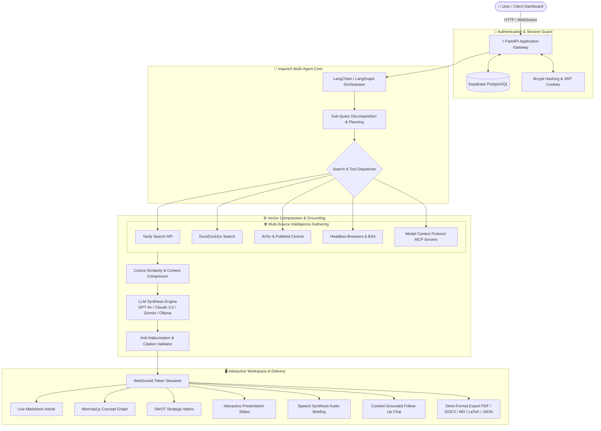
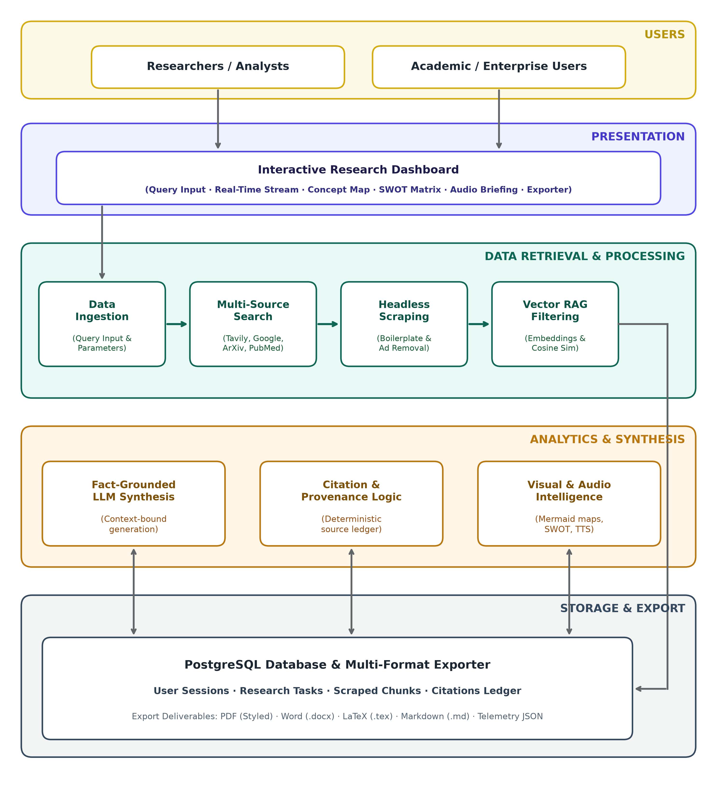
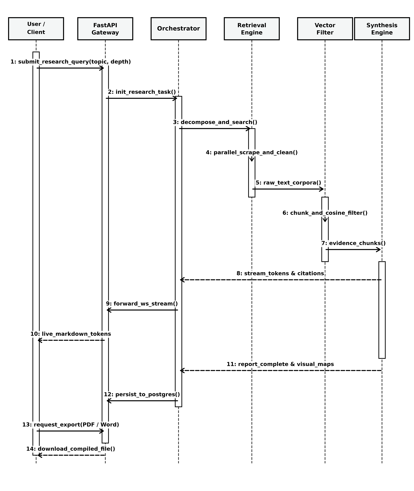

<div align="center">

# 🧠 InquireX

### Autonomous Deep Research Engine & Intelligence Platform
*Where knowledge meets autonomous inquiry.*

[](https://python.org)
[](https://fastapi.tiangolo.com)
[](https://langchain.com)
[](https://modelcontextprotocol.io)
[](https://m8ven.ai/mcp/bhaskararao-aerupilli/inquirex?s=readme)
[](https://supabase.com)
[](https://websockets.readthedocs.io)
[](LICENSE)

<p align="center">
  <b>InquireX</b> is a production-grade autonomous deep research platform powered by multi-agent decomposition, parallel web & academic retrieval, anti-hallucination vector compression, dynamic Mermaid.js concept graphs, interactive presentation slide generation, and AI voice audio briefings.
</p>

<!-- Live Preview Demo Above the Fold -->
<p align="center">
  
</p>

</div>

---

### ⚡ 30-Second Quickstart

Get InquireX running locally in 4 simple commands:

```bash
# 1. Clone the repository
git clone https://github.com/BhaskaraRao-Aerupilli/InquireX.git
cd InquireX

# 2. Create and activate virtual environment
python -m venv venv
# Linux / macOS:
source venv/bin/activate
# Windows PowerShell:
.\venv\Scripts\Activate.ps1

# 3. Install dependencies & configure keys
pip install -r requirements.txt
cp .env.example .env    # Add your OPENAI_API_KEY and TAVILY_API_KEY

# 4. Start the engine
python -m uvicorn main:app --host 127.0.0.1 --port 8000 --reload
```

Open [http://localhost:8000](http://localhost:8000) in your browser and enter any research question or hypothesis.

---

<div align="center">

[⚡ Quickstart](#-30-second-quickstart) • [🌟 Key Features](#-key-features) • [🏛️ System Architecture](#️-system-architecture) • [📐 UML Diagrams](#-system-design--uml-diagrams) • [💻 Tech Stack](#-tech-stack) • [🚀 Detailed Setup](#-detailed-installation--configuration) • [⚙️ Configuration](#️-environment-variables-reference) • [📁 Structure](#-project-structure) • [🔌 API Protocol](#-api--websocket-protocol) • [📄 License](#-license)

---

</div>

## 🌟 Key Features

### 🔍 Autonomous Multi-Agent Web Research
- **Dynamic Sub-Query Decomposition:** Automatically dissects complex research objectives and hypotheses into parallel, targeted search queries.
- **Concurrent Multi-Source Aggregation:** Concurrently queries diverse search engines and scientific repositories (**Tavily**, **DuckDuckGo**, **Google Search**, **Bing**, **ArXiv**, **PubMed Central**, and **SearXNG**).
- **Deep Web Crawling & Scraping:** Strips boilerplate, navigates dynamic web content, extracts clean prose, and deduplicates information across dozens of web pages simultaneously.

### 🛡️ Strict Anti-Hallucination & Provenance Verification
- **Evidence-Grounded Synthesis:** Enforces strict contextual alignment where every synthesis claim must be supported by retrieved and verified source vectors.
- **Deterministic Citation Ledger:** Automatically catalogs, validates, and hyperlinks all visited primary sources into an indexed bibliography.
- **Real-Time Provenance Telemetry:** Live calculation of prose word counts, estimated read times, cited primary sources, and verified analytical pillars.

### 📊 Interactive Visual Intelligence
- **Mermaid.js Concept Graphs:** Generates zoomable, pan-enabled concept graphs illustrating core entities and ontological relationships extracted from the findings.
- **SWOT Strategic Analysis Matrix:** Evaluates research outcomes into actionable Strengths, Weaknesses, Opportunities, and Threats.
- **Topic-Adaptive Exploration Vectors:** Proposes contextual follow-up exploration vectors and unanswered research questions tailored to the subject.

### 🖥️ Interactive Presentation Slide Deck
- **Instant Slide Generation:** Converts complex synthesized reports into an interactive slide deck presentation with one click.
- **Full-Viewport Modal & Navigation:** Responsive presentation overlay with keyboard shortcuts (<kbd>←</kbd> / <kbd>→</kbd> / <kbd>Space</kbd> / <kbd>Esc</kbd>), slide counter, and clean section transitions.
- **Slide Deck PDF Export:** Direct printing and PDF saving capability for stakeholder presentations.

### 🎙️ AI Voice Audio Briefings
- **In-Browser Audio Narration:** Built-in speech synthesis engine delivering hands-free executive briefings directly from report content.
- **Playback & Speed Modulation:** Dedicated toolbar audio player with speed modulation (`0.85x` - `1.0x`) and audio waveform visualizer.

### 📄 Omni-Format Document Export Suite
Export research documents with one click via a non-intrusive floating popover menu with client-side dynamic fallbacks:
- 📕 **PDF Document (.pdf)**: High-resolution print-ready document formatted with typography and header metadata.
- 📘 **Word Document (.docx)**: Microsoft Word document styled with callouts, code blocks, tables, and headings.
- 📝 **Markdown (.md)**: Plain-text clean documentation formatted with standard GitHub-Flavored Markdown.
- 📑 **Academic LaTeX (.tex)**: Camera-ready preprint manuscript formatted with `amsmath`, `hyperref`, and `booktabs`.
- 📊 **Log Trace Telemetry (.json)**: Full session execution provenance, sub-queries, scraped URLs, timestamps, and agent step traces.

### 🔌 Model Context Protocol (MCP) Support
- **Universal Tool Extensibility:** Native integration with the Anthropic Model Context Protocol (`mcp`), empowering agents to query local file systems, databases, GitHub repositories, and private enterprise tool servers.

### 🎭 Specialized Research Personas
- Dynamic agent routing tailored to specific domains:
  - 🤖 **Auto Agent:** Autonomous dynamic routing based on inquiry domain.
  - 📈 **Business & Market Analyst:** Strategic commercial insights, competitive analysis, and market trends.
  - 🎓 **Academic Researcher:** Peer-reviewed rigor, scientific method focus, and formal literature review.
  - 💻 **Technical Lead:** Architecture breakdowns, code implementation trade-offs, and technical feasibility.

### 🎨 Responsive UI/UX & Dual Theme Engine
- **100% Fluid Responsive:** Fully optimized across screen widths from 320px mobile devices to 4K ultra-wide monitors.
- **Dual Theme Support:** Seamless instant switching between Cyberpunk Glassmorphism Dark Mode and Pure Crisp Light Mode with zero dark-bleeding artifacts.

### 💬 Context-Aware Follow-Up Chat
- **Report Memory Persistence:** Interactive Q&A chat assistant directly grounded in the synthesized research report to ask follow-up questions or request deeper analysis.

### 🔐 Enterprise Authentication & Session Security
- **Supabase PostgreSQL Database:** Secure user credential management and profile persistence.
- **Bcrypt & JWT Security:** High-performance salted password hashing with stateless JSON Web Tokens stored in HTTP-only cookies.

---

## 🏛️ System Architecture



---

## 📐 System Design & UML Diagrams

InquireX is engineered with formal software architecture principles. Below are the comprehensive architectural, behavioral, and structural diagrams of the platform:

### 1. System Architecture Diagram
High-level component architecture illustrating the client tier, application gateway, multi-agent orchestration core, retrieval subsystem, vector filtering pipeline, and external integrations.

<div align="center">
  
</div>

---

### 2. Sequence Diagram
Step-by-step chronological sequence detailing client WebSocket initialization, sub-query decomposition, parallel scraping, vector compression, iterative report token streaming, and history persistence.

<div align="center">
  
</div>

---

### 3. Activity Diagram
Complete end-to-end operational workflow showing parallel execution branches, decision nodes, anti-hallucination validation, error fallback paths, and final multi-format artifact generation.

<div align="center">
  
</div>

---

### 4. Data Flow Diagram (DFD)
Level-0 and Level-1 data flow representation depicting data stores, process transformations, external entities, and telemetry streams through the research lifecycle.

<div align="center">
  
</div>

---

### 5. Class Diagram
Object-oriented class hierarchy detailing the core abstractions (`InquireXResearcher`, `Agent`, `Retriever`, `Scraper`, `ContextCompressor`, `ReportGenerator`, `AuthService`, and `WebSocketManager`).

<div align="center">
  
</div>

---

### 6. Database Entity-Relationship Diagram (ERD)
PostgreSQL / Supabase relational schema model covering user profiles, authentication credentials, research sessions, citation ledgers, and telemetry records.

<div align="center">
  
</div>

---

### 7. Use Case Diagram
Comprehensive actor-to-system interactions capturing user capabilities (running deep research, configuring MCP tools, presenting slide decks, exporting documents, and initiating follow-up chat dialogues).

<div align="center">
  
</div>

---

## 💻 Tech Stack

| Layer | Technologies & Libraries |
| :--- | :--- |
| **Backend Core** | Python 3.11+, FastAPI, Uvicorn, AsyncIO, Pydantic v2 |
| **Agentic Framework** | LangChain v1, LangGraph, LiteLLM |
| **Supported LLMs** | OpenAI (GPT-4o, GPT-4o-mini), Anthropic (Claude 3.5 Sonnet), Google Gemini (Gemini 2.0 Flash / Pro), Ollama (Local LLMs), Groq, Mistral |
| **Search Retrievers** | Tavily Search, DuckDuckGo (`ddgs`), ArXiv, PubMed Central, Google Search, Bing, SearXNG |
| **Scraping & Ingestion**| BeautifulSoup4, PyMuPDF (`fitz`), LXML, Unstructured, Playwright |
| **Vector RAG & Embeddings** | LangChain Text Splitters, OpenAI Embeddings, Cosine Similarity, Tiktoken |
| **Tool Extensibility** | Model Context Protocol (`mcp`), `langchain-mcp-adapters` |
| **Database & Auth** | Supabase, PostgreSQL, `bcrypt`, Python-JOSE (JWT), HTTP-Only Cookies |
| **Frontend UI** | HTML5, CSS3 Glassmorphism, Vanilla JS (ES6+), Bootstrap 4, FontAwesome 6 |
| **Visualization & Speech**| Mermaid.js v10, Showdown.js, DOMPurify, Web Speech API (SpeechSynthesis) |
| **Document Exporting** | `python-docx`, `htmldocx`, `weasyprint`, KaTeX, LaTeX Engine, Blob API |

---

## 🚀 Detailed Installation & Configuration

### 1. Prerequisites
- **Python 3.11+** installed on your system.
- **Git** installed.
- (Recommended) An [OpenAI](https://platform.openai.com) or [Anthropic](https://console.anthropic.com) API key, and a [Tavily](https://tavily.com) API key for live search.

### 2. Clone the Repository
```bash
git clone https://github.com/BhaskaraRao-Aerupilli/InquireX.git
cd InquireX
```

### 3. Create & Activate Virtual Environment
```bash
# Windows (PowerShell)
python -m venv venv
.\venv\Scripts\Activate.ps1

# Linux / macOS
python3 -m venv venv
source venv/bin/activate
```

### 4. Install Dependencies
```bash
pip install --upgrade pip
pip install -r requirements.txt
pip install -e .
```

### 5. Configure Environment Variables
Copy the template configuration file:
```bash
cp .env.example .env
```
Open `.env` and fill in your keys:
```ini
# LLM Provider Configuration
OPENAI_API_KEY=your_openai_api_key_here
# ANTHROPIC_API_KEY=your_anthropic_api_key_here
# GEMINI_API_KEY=your_gemini_api_key_here

# Search Retriever
RETRIEVER=tavily
TAVILY_API_KEY=your_tavily_api_key_here

# Model Selection
SMART_LLM_MODEL=gpt-4o
FAST_LLM_MODEL=gpt-4o-mini

# Supabase Authentication (Optional)
SUPABASE_URL=your_supabase_project_url
SUPABASE_ANON_KEY=your_supabase_anon_key
SUPABASE_SERVICE_ROLE_KEY=your_supabase_service_role_key
SECRET_KEY=generate_a_secure_random_hex_key
```

### 6. Launch the InquireX Server
```bash
python -m uvicorn main:app --host 127.0.0.1 --port 8000 --reload
```

Open your browser and navigate to:
```
http://127.0.0.1:8000
```

---

## ⚙️ Environment Variables Reference

| Variable | Description | Default |
| :--- | :--- | :--- |
| `OPENAI_API_KEY` | OpenAI API Key for GPT models and embeddings | Required (or Anthropic/Gemini) |
| `TAVILY_API_KEY` | Tavily Search API key for deep web research | Recommended |
| `ANTHROPIC_API_KEY` | Anthropic API key for Claude 3.5 Sonnet | Optional |
| `GEMINI_API_KEY` | Google Gemini API key | Optional |
| `SMART_LLM_MODEL` | High-parameter model used for report synthesis | `gpt-4o` |
| `FAST_LLM_MODEL` | Fast lightweight model for query planning & summarization | `gpt-4o-mini` |
| `RETRIEVER` | Primary search retriever (`tavily`, `duckduckgo`, `google`, `searx`) | `tavily` |
| `MAX_SEARCH_RESULTS_PER_QUERY` | Maximum number of websites scraped per sub-question | `5` |
| `TOTAL_WORDS` | Target minimum length for generated reports | `1200` |
| `DOC_PATH` | Directory path for local file retrieval (private RAG) | `./my-docs` |
| `SUPABASE_URL` | Supabase instance URL for user database | Optional |
| `SUPABASE_SERVICE_ROLE_KEY` | Supabase service-role key for authentication management | Optional |
| `SECRET_KEY` | Secret key for JWT cookie encryption | Random string |

---

## 📁 Project Structure

```
InquireX/
├── backend/
│   ├── auth/                  # Supabase database client, Bcrypt hashing, JWT auth middleware
│   ├── chat/                  # Context-aware chat agent with report memory
│   ├── report_type/           # Research strategies (Basic, Detailed, Deep Research)
│   └── server/                # FastAPI app routes, WebSocket streaming manager, utilities
├── frontend/
│   ├── index.html             # Main InquireX interactive dashboard & presentation modal
│   ├── login.html             # User authentication sign-in
│   ├── register.html          # User registration page
│   ├── scripts.js             # Client controller, WebSocket handler, Slides, Mermaid & Audio engine
│   └── styles.css             # Glassmorphism dark-cyberpunk & pure crisp light theme CSS
├── inquirex/                  # Core InquireX deep research engine & autonomous intelligence
│   ├── actions/               # Query generation, web scraping, markdown processing
│   ├── document/              # Multi-format document ingestion loaders (PDF, DOCX, TXT)
│   ├── llm_provider/          # LLM integrations (OpenAI, Claude, Gemini, Ollama, Groq)
│   ├── memory/                # Vector embeddings and context stores
│   ├── retrievers/            # Multi-engine search connectors (Tavily, DDG, Google, ArXiv, MCP)
│   ├── scraper/               # Resilient web page scrapers & text extractors
│   ├── skills/                # Research planner, context compression, synthesis engine
│   └── utils/                 # LLM token counters, sanitizers, and helper functions
├── agent_teams/               # Multi-agent collaborative orchestration (LangGraph & AG2)
├── autonomous_agents/         # Autonomous deep research agent harnesses & benchmarks
├── outputs/                   # Automatically generated reports (.md, .pdf, .docx, .json)
├── activity_diagram.png       # UML Activity Diagram
├── class_diagram.png          # UML Class Diagram
├── data_flow_diagram.png      # Level 0 & 1 Data Flow Diagram
├── database_er_diagram.png    # Database Entity-Relationship Diagram
├── sequence_diagram.png       # UML Sequence Diagram
├── system_architecture.png    # Complete System Architecture Diagram
├── use_case_diagram.png       # UML Use Case Diagram
├── main.py                    # Application entry point
├── requirements.txt           # Python package dependencies
└── README.md                  # Comprehensive project documentation
```

---

## 🔌 API & WebSocket Protocol

### Authentication Endpoints
- `POST /api/auth/register`: Register a new user account with email and password.
- `POST /api/auth/login`: Authenticate credentials, set HTTP-only JWT session cookie.
- `POST /api/auth/logout`: Revoke active session and clear authentication cookies.
- `GET /api/auth/me`: Retrieve currently authenticated user profile.

### Real-Time WebSocket Channel (`/ws`)
Connect to `ws://127.0.0.1:8000/ws` for live bidirectional research streaming.

#### Client Initiation Payload:
```json
{
  "task": "Quantum Computing Impact on Post-Quantum Cryptography",
  "report_type": "detailed_report",
  "report_source": "web",
  "tone": "Formal",
  "agent": "Technical Lead",
  "max_search_results": 5,
  "mcp_enabled": false
}
```

#### Server Streaming Event Types:
- `logs`: Emitted during each step with agent planning logs, generated subqueries, scraped source URLs, and pipeline state changes.
- `images`: Emitted with scraped figures and visual metadata discovered during research.
- `report`: Progressive stream of synthesized markdown report tokens.
- `path`: Emitted upon research completion containing the URLs of generated export files (PDF, DOCX, MD, JSON).
- `chat`: Bidirectional follow-up questions and answers grounded in the finished report.

---

## 🤝 Contributing

Contributions are warmly welcomed! To contribute:
1. Fork the repository.
2. Create a feature branch (`git checkout -b feature/amazing-feature`).
3. Commit your changes (`git commit -m 'feat: add amazing feature'`).
4. Push to the branch (`git push origin feature/amazing-feature`).
5. Open a Pull Request.

---

## 📄 License

This project is licensed under the **MIT License** — see the [LICENSE](LICENSE) file for details.

<div align="center">
  <sub>Developed by <b>Bhaskara Rao Aerupilli</b> & the InquireX Open Source Community.</sub>
</div>
